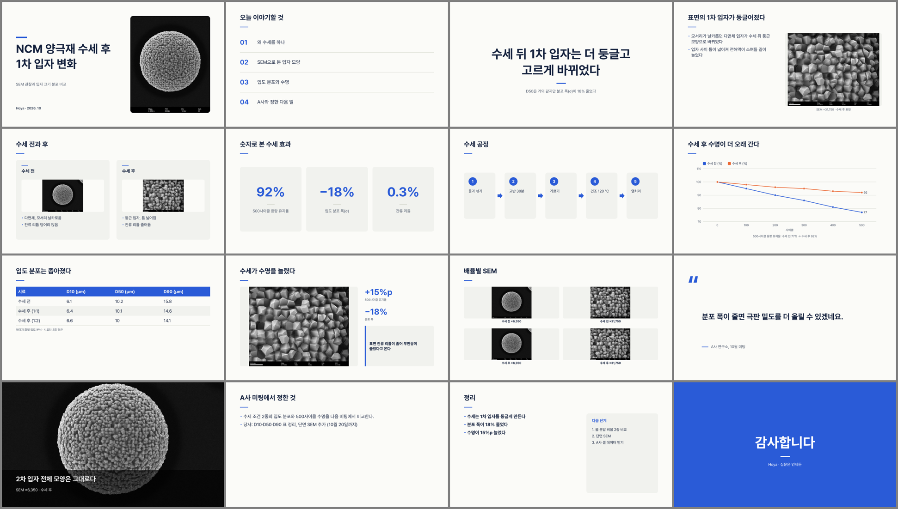
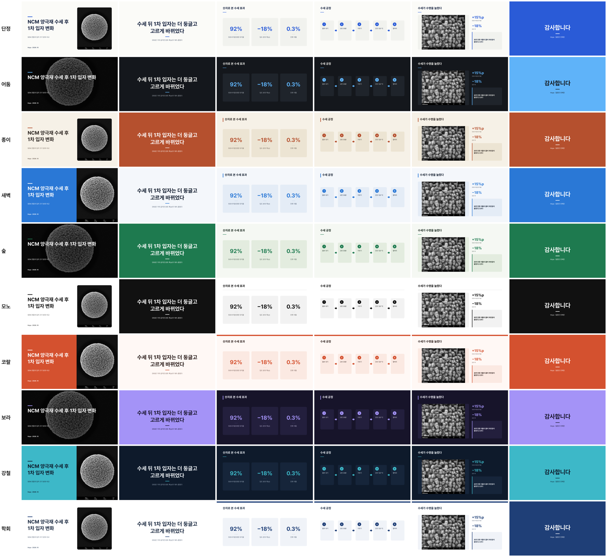

# 덱편집기 (research-deck-maker) — 실험 데이터로 발표 덱 만들기

실험 메모·엑셀·사진(SEM 등)·회의록 PDF로 발표 덱을 만드는 앱이에요.
Claude가 **덱설계 JSON**을 쓰고, 앱은 그걸 배치하고 굽기만 해요(앱 안에는 AI가 없어요).
결과는 **글자·차트가 살아 있는 PPTX**, PDF, 장 그림 묶음(PNG), 발표 영상(mp4), 대본, 데이터 엑셀이에요.



## 받기
이 페이지 위쪽 초록색 **Code → Download ZIP**을 눌러 받아요(로그인 필요 없어요).
압축을 풀면 `research-deck-maker-main` 폴더가 생겨요. 아래의 파일들은 모두 그 폴더 안에 있어요.

## 켜기 (Windows)
0. ZIP으로 받았다면 압축을 풀기 전에 ZIP 파일 → 오른쪽 클릭 → 속성 → **차단 해제**를 체크해요(회사 PC가 .bat 실행을 막지 않게).
   `C:\덱편집기`처럼 짧은 경로에 푸는 게 좋아요(바탕 화면·OneDrive 안은 경로가 길어져요).
1. `준비하기.bat`: 처음 한 번만 눌러요. 파이썬 3.10 이상이 필요해요.
   - 관리자 권한 없이 이 폴더 안에 `.venv`를 만들고 꾸러미를 깔아요.
2. `켜기.bat`: 브라우저에 `http://127.0.0.1:8780`이 열려요.
3. 화면 없이 한 번에 굽기: `덱설계.json`을 `덱만들기.bat` 위에 끌어다 놓아요.

Mac은 `켜기.command`를 눌러요.

## Claude로 덱 만들기 (명령 세 개)
```
python 재료넣기.py <덱이름> 실험메모.md 데이터.xlsx 회의록.pdf SEM.tif   # 재료 넣기 → 재료요약.md
#   Claude가 재료요약.md 를 읽고 프로젝트/<덱이름>/덱설계.json 을 써요
python 덱만들기.py <덱이름>                                                # 감독관 점검 + 결과 전부
```
- Claude가 따르는 규칙: `덱설계_쓰는법.md`, 스키마 `덱설계.schema.json`
- Claude Code 스킬: `.claude/skills/deck-design/SKILL.md`
- 첫 실전 덱: `프로젝트/A사_2차미팅_수세조건/` (본보기 실험 메모 + 엑셀 + SEM 사진 + 회의록으로 만든 11장)

## 화면
| 자리 | 하는 일 |
|---|---|
| 레일(왼쪽) | 덱 · 장 · 재료 · 테마 · 꾸미기 · 감독관 · 내보내기 |
| 가운데 | 지금 장(크게), 아래는 장 띠. 끌어서 순서를 바꿔요 |
| 살피는 칸(오른쪽) | 글 고치기, 그림 고르기, 발표자 노트, 앞뒤로 옮기기, 이 장 빼기(휴지통) |
| 위 오른쪽 `PPTX 굽기` | 지금 덱을 고칠 수 있는 PPTX로 바로 구워요 |

| 탭 | 하는 일 |
|---|---|
| 덱 | 새 덱(빈 덱, 또는 **PPTX v1에서 시작** → 템플릿 그대로 v2), 덱 고르기 |
| 장 | 장 종류 16가지(표지·목차·한마디·글그림·글만·비교·숫자·흐름·도표·표·인용·사진가득·결과해석·사진격자·결론·끝) |
| 재료 | PDF 회의록·PPTX·엑셀/CSV·사진·mp4·Origin·글을 넣고, 끌어서 장에 넣어요 |
| 테마 | 스타일 10개 + **해부**: 마음에 드는 PPTX를 넣으면 색·글자체·제목 장식을 읽어 한 번에 입혀요 |
| 꾸미기 | 배경 무늬·사진 효과·테두리·그림자·모서리. 기본은 없음. 사진 효과는 원본 화소를 바꾸지 않아요 |
| 감독관 | 넘침·견본 글·숫자의 정직(막대 0 시작, 합 100)·없는 그림·해상도·대비·되풀이를 살펴요. 고침 단추는 눌러야만 바뀌어요 |
| 내보내기 | PPTX · PDF · PNG 묶음 · mp4 · 대본 · 데이터 · 그림 원본. 감독관이 멈추면 굽기 전에 물어요 |

- **고친 내용:** 바로 `덱설계.json`에 저장돼요. 이전 판은 `.이전/`에 남아요.
- **뺀 장:** 지우지 않고 휴지통에 남아요. 덱 탭의 휴지통에서 누르면 원래 자리로 되살아나요.
- **구운 결과:** `내보내기/날짜_시각/`에 쌓여요. 지우거나 덮어쓰지 않아요. 내보내기 탭의 '폴더 열기'로 바로 열어요.
- **SEM 사진:** 기본은 잘리지 않게 '담기'라 스케일바가 남아요. 표지·사진가득 장은 '맞춤'에서 '채우기'를 고를 수 있고, 잘리면 감독관이 알려요.
- **그림:** 원본 화질 그대로 PPTX에 들어가요(TIFF는 무손실 PNG로). 내보내기의 '그림 원본'은 파일을 그대로 복사해요.
- **v1 → v2:** v1 파일은 절대 고치지 않아요. `<이름>_v2.pptx`와 `변경기록.md`를 만들어요.

## 회사 PC에서 (보안·IT 담당자용 설명)
- **권한:** 관리자 권한, 설치 프로그램, 레지스트리 변경이 필요 없어요. 사용자 폴더 안에서만 돌아가요.
- **네트워크:** 서버는 `127.0.0.1`(이 PC 안)에서만 열려요. 바깥 인터넷으로 보내는 기능은 없어요.
  - 이 PC의 덱편집기 화면에서 온 요청만 받아요(다른 웹사이트가 몰래 부르는 것을 막아요).
  - AI 연결(API)은 나중에 선택 기능으로 둘 거예요. 기본은 꺼져 있어요.
- **굽기:** 윈도우에 기본으로 있는 Edge를 헤드리스로 불러요. PPTX 확인은 설치된 PowerPoint를 쓰고, 열려 있는 다른 문서는 건드리지 않아요.
- **영상(mp4):** PC에 있는 ffmpeg(또는 `도구\ffmpeg.exe`)를 불러요. 없으면 영상만 건너뛰어요.
- **꾸러미 설치:** 인증서 검사를 끄지 않아요. 윈도우 인증서 저장소(truststore)로 회사 인증서를 확인해요.
  - 오래된 pip에서도 되도록 truststore 설치 파일을 `준비물\`에 넣어 두었어요(인터넷 없이 먼저 깔아요).
  - 인터넷 설치가 막혀 있으면 `꾸러미\` 폴더(미리 받은 wheel 묶음)로 오프라인 설치해요.
- **기본 글자체:** 맑은 고딕(윈도우 기본)이라 글자체를 설치할 필요가 없어요.
  - Pretendard(OFL)는 `글자체/`에 들어 있고, 고를 때만 써요.

| 쓰는 것 | 라이선스 |
|---|---|
| python-pptx | MIT |
| lxml | BSD |
| Pillow | HPND |
| numpy | BSD |
| pypdfium2 | Apache-2.0 / BSD-3 |
| openpyxl | MIT |
| XlsxWriter | BSD-2 |
| Pretendard | OFL-1.1 |
| truststore (준비물에 포함) | MIT |
| ffmpeg (있을 때만, 따로 실행) | LGPL / GPL |

## 폴더
```
research-deck-maker/
  서버.py  엔진.py  배치.py  그리기_html.py  그리기_pptx.py  굽기.py  소재.py  스타일.py
  재료받기.py  바탕pptx.py  해부.py  감독관.py  꾸밈.py  내보내기.py  도표.py
  덱만들기.py  재료넣기.py  설계틀.py      ← 명령으로 쓰는 것
  덱설계_쓰는법.md  덱설계.schema.json     ← Claude가 읽는 것
  감독관시험/                             ← python 감독관.py 시험 (늘 0 틀림)
  화면/(index.html app.js app.css)   글자체/   내스타일/(해부로 만든 스타일)
  프로젝트/<덱>/(덱설계.json 재료/ 재료요약.md 내보내기/ .이전/)
```

## 스타일 10개


## 예제 덱 (`프로젝트/`)
모두 시험용으로 꾸민 가짜 자료예요.
| 덱 | 내용 |
|---|---|
| 본보기_장종류모음 | 장 종류 16가지를 한 번씩 |
| 본보기_양극재수세 | 회의록 PDF·엑셀·SEM 사진으로 만든 7장 |
| A사_2차미팅_수세조건 | Claude가 실험 메모로 쓴 첫 실전 덱(11장) |
| ACME_중간보고 | 회사 템플릿 v1 → v2 고치기 예제 |

## 시험 (개발자용)
```
pip install -r requirements.txt pytest jsonschema
python -m pytest tests
python 감독관.py 시험
```

## 확인한 것 / PC에서 확인할 것
- 여기서(리눅스, Chromium, LibreOffice) 확인: 화면 조작, PNG·PDF·PPTX·mp4, PPTX를 다시 열어 장 수·글상자·차트, 덱편집기 시험 34개.
- 마지막 점검(점검 에이전트 4 + 감독관 2, 2026-10-14)에서 나온 '꼭 고침' 15건과 '고치면 좋음' 일부를 고쳤어요.
- 호야 PC에서 처음 확인할 것: 실제 PowerPoint로 열기, 맑은 고딕 글자 폭, `.bat` 파일, Origin 파일, 회사 네트워크에서 설치.
